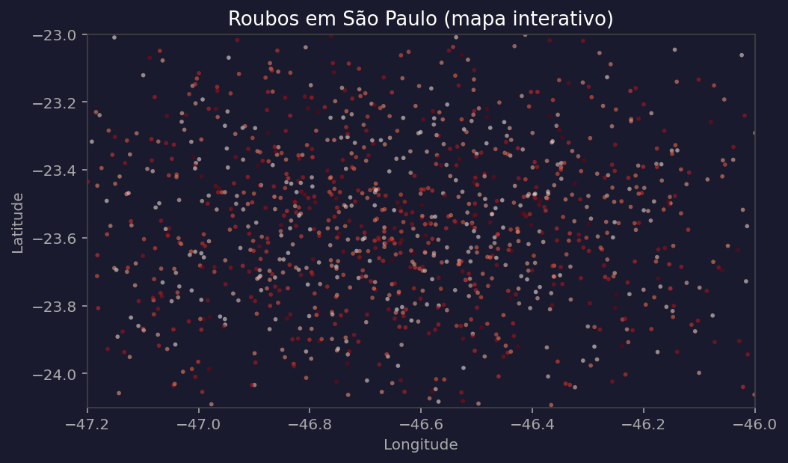
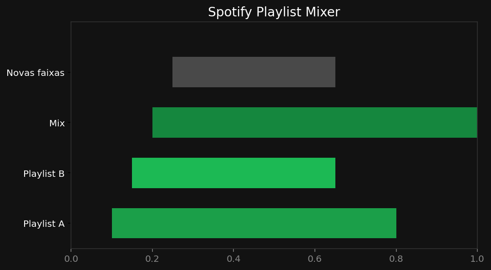

# Olá, eu sou Daniel Lopes

**Estatística · ciência de dados · R · Python · Shiny**

Projetos abaixo com visuais e código reproduzível

---

  
  &nbsp;
  

  
  
  
  
  

## Destaques — projetos com visualização

<table>
<tr>
<td width="50%">

### [PCA Spotify](https://github.com/DanielLopesEstatistica/pca-spotify)
Features de playlists + análise de componentes principais (R e Python).

</td>
<td width="50%">

### [Mandelbrot](https://github.com/DanielLopesEstatistica/mandelbrot)
Conjunto de Mandelbrot e visualização em R.

</td>
</tr>
<tr>
<td width="50%">

### [Lei de Benford](https://github.com/DanielLopesEstatistica/benfords-law)
Primeiro dígito em votos — TSE 2022 vs. expectativa teórica.

</td>
<td width="50%">

### [Análise numérica](https://github.com/DanielLopesEstatistica/analise-numerica)
Compressão de imagens com processamento paralelo em R.

</td>
</tr>
<tr>
<td width="50%">

### [Bitcoin — GARCH](https://github.com/DanielLopesEstatistica/bitcoin-garch)
Volatilidade e previsão de retornos de BTC-USD.

</td>
<td width="50%">

### [Jogo da velha (minimax)](https://github.com/DanielLopesEstatistica/jogo-da-velha)
IA minimax em R — projeto interativo e didático.

</td>
</tr>
<tr>
<td width="50%">

### [Roubos em São Paulo](https://github.com/DanielLopesEstatistica/Roubos-em-Sao-Paulo)
Mapa interativo na região metropolitana · [ver online](https://daniellopesestatistica.github.io/Roubos-em-Sao-Paulo/).

</td>
<td width="50%">

### [Spotify Playlist Mixer](https://github.com/DanielLopesEstatistica/Spotify-Playlist-Mixer)
Mistura de playlists com a API oficial do Spotify (Python).

</td>
</tr>
</table>

## Outros repositórios públicos que vale explorar

| | Projeto | Ideia |
|---|---------|--------|
| 📈 | [Séries temporais (ME607)](https://github.com/DanielLopesEstatistica/series-temporais-me607) | ARIMA, GARCH e Shiny |
| 🧠 | [Attractiveness Recognizer](https://github.com/DanielLopesEstatistica/Attractiveness-Recognizer) | Redes neurais (CelebA) |
| 📊 | [Demografia](https://github.com/DanielLopesEstatistica/demografia) | Tábuas de vida |
| 💣 | [Minesweeper](https://github.com/DanielLopesEstatistica/minesweeper) | Campo minado |

---

  Perfil mantido por Daniel Lopes — repositórios com README e prévia em <code>docs/preview.png</code> quando disponível.

